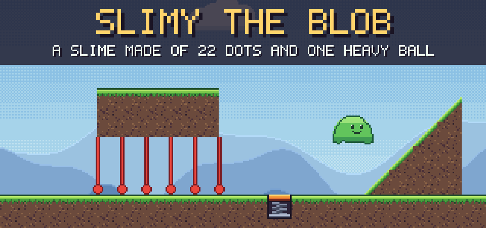
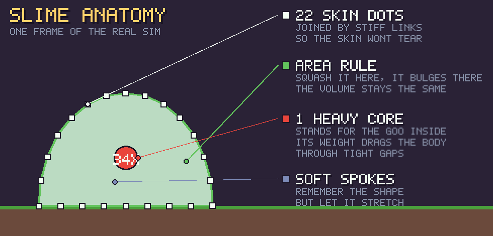
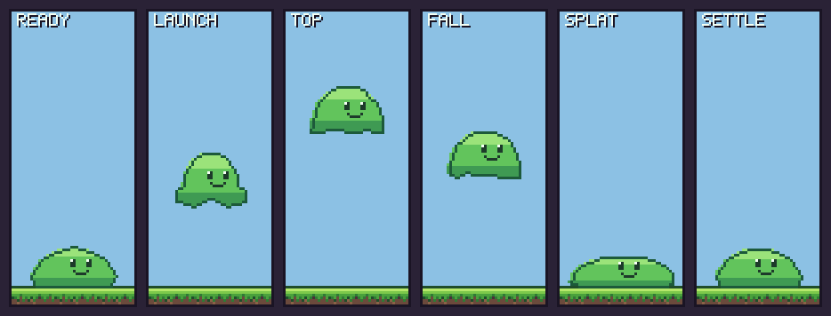
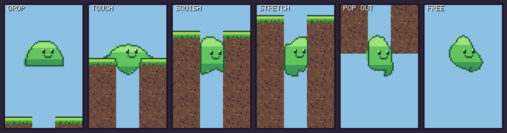
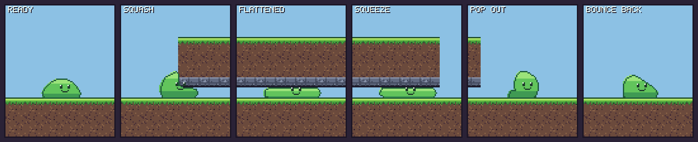
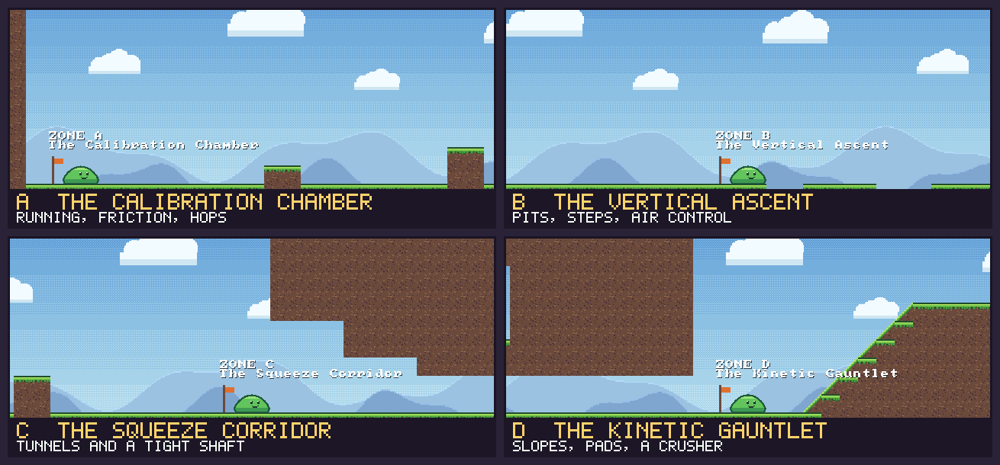
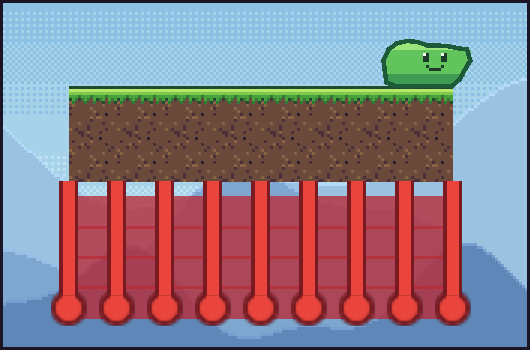
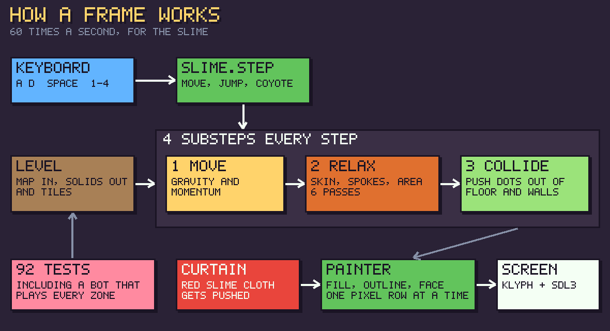

<p align="center">
  
</p>

<p align="center">
  <b>a soft-body slime platformer test level</b><br>
  made in Kotlin with the <a href="https://github.com/inemtsev/klyph">klyph</a> game engine
</p>

---

## ⚡ 10-second version

- 🟢 the slime is **not a sprite**. it's a blob of physics dots
- 🕳️ it **squeezes through holes smaller than itself**
- 🗺️ **4 zones**, each tests one thing
- 🤖 a **bot plays every zone** to check you can actually finish it
- 🧪 **92 tests**, all green

## ▶️ Play it

```
./gradlew run
```

| key | does |
|---|---|
| `A` `D` / arrows | move |
| `Space` / `W` / `Up` | jump (hold = higher) |
| `1` `2` `3` `4` | teleport to a zone |
| `R` | restart zone |
| `F2` | show the physics dots 👀 |

---

## 🧬 What the slime is made of



**22 dots** make the skin. **1 heavy ball** in the middle is the goo inside. That's the whole slime.
Every frame the dots push and pull on each other, and that's what you see wobbling.

## 🍮 It squishes



Nobody animated this. These are **real frames from the physics**: it stretches when it launches,
flattens when it lands, then settles back.

## 🕳️ It squeezes through gaps

The shaft is **60% as wide as the slime**. Low tunnel? Same deal, **60% of its height**.





The trick is the **heavy core**. When the skin gets stuck on an edge, the core's weight drags the
whole body through. 🪄

---

## 🗺️ 4 zones



| zone | what it tests |
|---|---|
| **A** | running, friction, little hops |
| **B** | pits up to 4 tiles wide, stairs, air control |
| **C** | 3 tunnels getting lower, then a 1-tile shaft you have to hop onto |
| **D** | a 45° hill, bounce pads, a crusher, and a ledge only a bounce reaches |

## 🔴 Red slime curtain



Bounce up to the ledge in zone D and push through the red curtain. 💥

It's cloth made of the same kind of dots. Touch it, it swings. Leave it, it settles.
The slime pushes it, it doesn't push back.

<br clear="right">

---

## ⚙️ How it works (one frame)



60 times a second the slime does **move → relax → collide**, four times, in tiny steps.
That's why it doesn't tunnel through walls or explode.

## 📁 Where stuff is

| folder | what |
|---|---|
| `klyph-physics/` | the reusable part: soft bodies made of dots, their outline, tiles and slopes they get pushed out of. **Its own module**, knows nothing about the slime, so it can move into klyph later |
| `physics/` | the slime (its input, jump and tuning) and the curtain, built on `klyph-physics`. **No engine code here** (that's why it's testable) |
| `level/` | the level is a **text map**: `#` ground, `v` low ceiling, `J` bounce pad, `M` crusher, `r` curtain |
| `render/` | draws the slime one pixel row at a time (klyph has no polygons) |
| `GameSession.kt` | the rules: step order, jump buffering, falling out, restarts. **Also no engine code**, so a test plays the same code the game runs |
| `Game.kt` | a thin adapter: reads the keyboard into the session and draws what it holds |
| `art/` | scripts that draw the pixel art, and this README's pictures |

---

## 🐛 Bugs we hit (the fun ones)

- **The rigid slime.** First version sat on a hole like a lid. Numbers didn't help. It needed a *different model*: soft constraints plus the heavy core.
- **The impassable level.** The bot played zone C and got stuck forever: the last tunnel opened straight into a wall. A human would've found that in an hour. The bot found it in a second.
- **The hollow ring.** The slime's outline can fold over itself. The old fill rule treated the folded part as "outside" and left it **empty**. Now it fills by winding number, so folds stay solid.

## 🧪 Tests

**92 tests**, and some of them are a **bot** that runs the real level on the real physics:
hold right, jump at walls and gaps. If the bot can't finish a zone, the zone is broken.

```
./gradlew allTests
```

---

<p align="center">
  more details, controls and the full test list → <a href="docs/DETAILS.md"><b>docs/DETAILS.md</b></a><br>
  <sub>every picture here comes from the game itself: <code>python3 art/readme/draw.py</code></sub>
</p>
